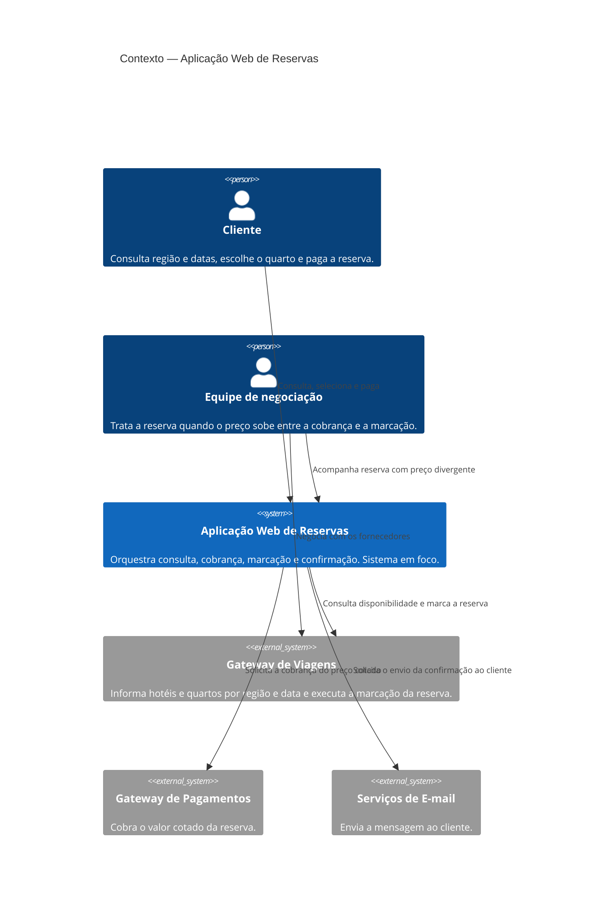
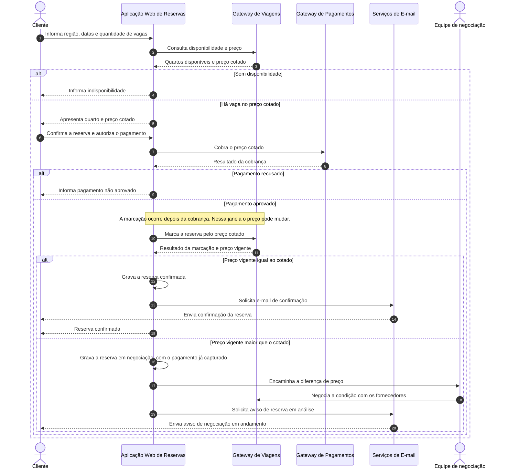

# Objetivo

1 - Construir diagrama C4 nível de sistemas ( c4.md ). Tome cuidado para os elementos não ficarem um em cima do outro.

2 - Construir um diagrama de sequência (UML) para detalhar um processo crítico ( sequencia.md )

Utilizando mermaid crie esses diagramas usando o escopo abaixo.

# Escopo 
Uma operadora de turismo vende reservas de hotél com vagas limitadas. O sistema em foco é uma aplicação web de reservas: o cliente consulta a região e datas, o sistema disponibiliza os hotéis e quartos disponíveis, o cliente seleciona o quarto desejado, realiza a marcação de reserva e o pagamento. 

Fora do sistema ficam apenas:

- Gateway de Viagens: Que disponíbiliza os hoteis disponiveis dentro de uma região e data; assim, como serviços explicitos para marcação de reserva. Cadastro de hotéis, pacotes, cancelamento, reembolso ocorrem dentro do Gateway de Viagens e estão fora do escopo dessa solução.

- Gateway de Pagametnos: Que permite o pagamento da reserva;

- Serviços de Email: Que envia a confirmação de email para o cliente quando tudo for finalizado

O processo crítico é a confirmação da reserva: o cliente escolhe data e quantidade de vagas, o sistema verifica a disponibilidade no gateway de viagens, pede a cobrança ao gateway de pagamento e, se o pagamento for aprovado, grava a reserva e dispara o e-mail de confirmação. Esse fluxo é o que o diagrama de sequência deve detalhar. O critico aqui é o pagamento é realizado fora do gateway de viagens, então existe duas decisões:

1 - Cobrar e depois marcar a reserva ( o preço pode mudar nesse tempo de 1 seg );
    -> Cliente paga X
    -> Ao marcar a reserva o preço flutuou e ficou mais caro;
        -> Caso isso aconteça, reserva passa por um processo humano de negociação com os fornecedores;
    -> Ao marcar a reserva o preço persistiu:
        -> Tudo certo com a reserva;

2 - Marcar, cobrar e se der falha cancelar a reserva
    -> Operação clara, porém, há hotéis que não permitem cancelamento gratuito;
    -> Operadora leva prejuizo;

Por uma decisão de negócio, optou-se pelo item 1.

# Contexto C4 — Aplicação Web de Reservas

A aplicação web é o único sistema da solução. Cliente e equipe de negociação são pessoas. Gateway de Viagens, Gateway de Pagamentos e Serviços de E-mail ficam fora da fronteira. A equipe entra no contexto porque a divergência de preço não é resolvida por sistema: ela é o caminho de exceção da decisão de cobrar primeiro.

# Sequência — Confirmação da reserva

O fluxo segue a decisão de negócio de cobrar antes de marcar. O cliente paga o preço cotado e só depois a aplicação pede a marcação ao Gateway de Viagens. A comparação acontece na resposta desse gateway. Preço igual encerra o processo com gravação e e-mail de confirmação. Preço maior deixa a cobrança feita e abre negociação humana. Nesse segundo caso o e-mail não confirma a reserva; ele avisa que ela está em análise.

