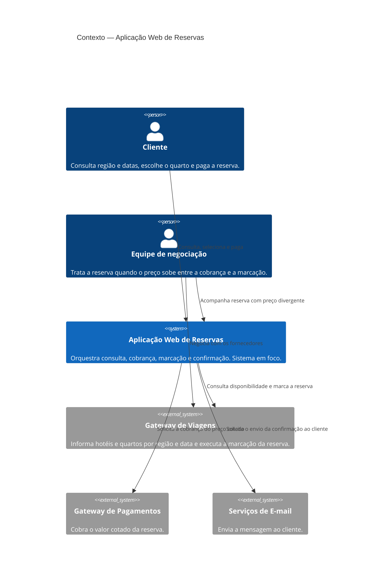

# Contexto C4 — Aplicação Web de Reservas

A aplicação web é o único sistema da solução. Cliente e equipe de negociação são pessoas. Gateway de Viagens, Gateway de Pagamentos e Serviços de E-mail ficam fora da fronteira. A equipe entra no contexto porque a divergência de preço não é resolvida por sistema: ela é o caminho de exceção da decisão de cobrar primeiro.

