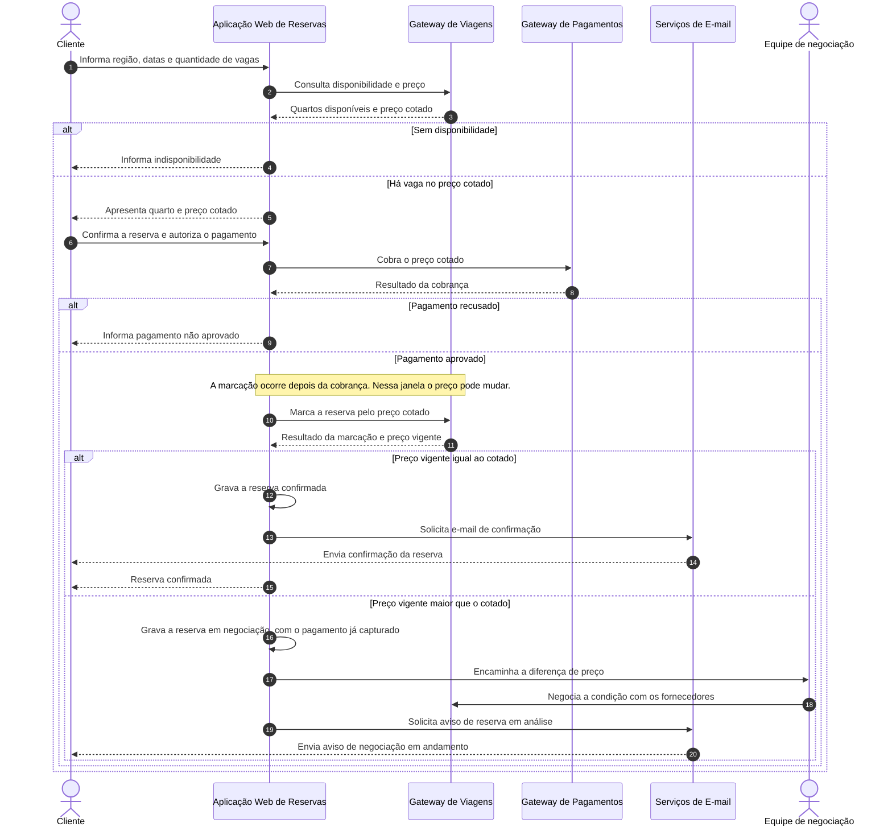

# Sequência — Confirmação da reserva

O fluxo segue a decisão de negócio de cobrar antes de marcar. O cliente paga o preço cotado e só depois a aplicação pede a marcação ao Gateway de Viagens. A comparação acontece na resposta desse gateway. Preço igual encerra o processo com gravação e e-mail de confirmação. Preço maior deixa a cobrança feita e abre negociação humana. Nesse segundo caso o e-mail não confirma a reserva; ele avisa que ela está em análise.

